<!-- Encabezado animado con GIFs decorativos -->

  
  

    
    
  
  

  

<!-- Contador de visitas -->

  

<!-- About Me -->

I'm a <strong>Software Developer</strong> focused on backend development, distributed systems, database engineering, cloud computing, and process automation.

I build <strong>REST APIs, asynchronous workflows, and database-driven applications</strong>, applying software engineering principles.

<!-- Contact Badges -->

  
  
  
  

<!-- Credentials -->

Certifications

  <a href="https://learn.microsoft.com/api/credentials/share/es-es/ANDREACARRILLOOPORTO-6553/79C80AEA4FDDB812?sharingId=4B17552443EC43C4" title="AZ-900 — Microsoft Certified: Azure Fundamentals — View credential"> AZ-900</a>
  &nbsp;&nbsp;
  <a href="https://learn.microsoft.com/api/credentials/share/es-es/ANDREACARRILLOOPORTO-6553/730444074E386CBE?sharingId=4B17552443EC43C4" title="GH-900 — GitHub Foundations — View credential"> GH-900</a>
  &nbsp;&nbsp;
  <a href="https://learn.microsoft.com/api/credentials/share/es-es/ANDREACARRILLOOPORTO-6553/2DC1174F7D2F1F1B?sharingId=4B17552443EC43C4" title="SC-900 — Microsoft Certified: Security, Compliance, and Identity Fundamentals — View credential"> SC-900</a>

 

<h3>💻 Core Tech Stack</h3>

<strong>Programming Languages</strong>

<table align="center">
  <tr>
    <td align="center"> Python</td>
    <td align="center"> C++</td>
    <td align="center"> Java</td>
    <td align="center"> C#</td>
    <td align="center"> JavaScript</td>
  </tr>
</table>

<strong>Backend, Databases &amp; API Testing</strong>

<table align="center">
  <tr>
    <td align="center"> FastAPI</td>
    <td align="center"> .NET</td>
    <td align="center"> Spring</td>
    <td align="center"> Postman</td>
  </tr>
  <tr>
    <td align="center"> PostgreSQL</td>
    <td align="center"> SQL Server</td>
    <td align="center"> MySQL</td>
    <td align="center"> MongoDB</td>
  </tr>
</table>

<strong>Cloud &amp; Distributed Systems</strong>

<table align="center">
  <tr>
    <td align="center"> Azure</td>
    <td align="center"> Docker</td>
    <td align="center"> RabbitMQ</td>
    <td align="center"> Redis</td>
    <td align="center"> GitHub Actions</td>
  </tr>
</table>

<h3>⚙️ Engineering Practices</h3>

<strong>Software Design:</strong> OOP · SOLID · Design Patterns · Data Structures · Algorithms

<strong>Software Architecture:</strong> REST APIs · Microservices · Distributed Systems · Asynchronous Messaging

<strong>Software Quality:</strong> Automated Testing · CI/CD · Version Control

<h3>🌿 Applied NLP Focus</h3>

  Natural Language Processing · spaCy · pdfplumber · information extraction · document automation

  
<strong>Additional Technologies</strong>

<table align="center">
  <tr>
    <th colspan="3" align="center">Backend &amp; Databases</th>
    <th colspan="3" align="center">Cloud &amp; DevOps</th>
  </tr>
  <tr>
    <td align="center" valign="middle"> VB.NET</td>
    <td align="center" valign="middle"> Django</td>
    <td align="center" valign="middle"> Node.js</td>
    <td align="center" valign="middle"> Git</td>
    <td align="center" valign="middle"> GitHub</td>
    <td align="center" valign="middle"> Azure DevOps</td>
  </tr>
  <tr>
    <td align="center" valign="middle"> Oracle</td>
    <td colspan="2"></td>
    <td align="center" valign="middle"> Cloudflare</td>
    <td align="center" valign="middle"> Netlify</td>
    <td align="center" valign="middle"> Vercel</td>
  </tr>
  <tr>
    <th colspan="3" align="center">Frontend Development</th>
    <th colspan="3" align="center">Data &amp; Automation</th>
  </tr>
  <tr>
    <td align="center" valign="middle"> HTML5</td>
    <td align="center" valign="middle"> CSS3</td>
    <td align="center" valign="middle"> React</td>
    <td align="center" valign="middle"> Power BI</td>
    <td align="center" valign="middle"> SSIS</td>
    <td align="center" valign="middle"> UiPath</td>
  </tr>
  <tr>
    <td align="center" valign="middle"> Vue.js</td>
    <td align="center" valign="middle"> Nuxt</td>
    <td align="center" valign="middle"> Bootstrap</td>
    <td align="center" valign="middle"> Pandas</td>
    <td align="center" valign="middle"> NumPy</td>
    <td align="center" valign="middle"> Matplotlib</td>
  </tr>
  <tr>
    <td align="center" valign="middle"> Vite</td>
    <td align="center" valign="middle"> Tailwind CSS</td>
    <td colspan="1"></td>
    <td align="center" valign="middle"> SciPy</td>
    <td colspan="2"></td>
  </tr>
  <tr>
    <th colspan="3" align="center">Mobile Development</th>
    <th colspan="3" align="center">Testing &amp; QA</th>
  </tr>
  <tr>
    <td align="center" valign="middle"> Kotlin</td>
    <td align="center" valign="middle"> Android Studio</td>
    <td colspan="1"></td>
    <td align="center" valign="middle"> Selenium</td>
    <td align="center" valign="middle"> NUnit</td>
    <td align="center" valign="middle"> PyTest</td>
  </tr>
  <tr>
    <th colspan="3" align="center">Tools &amp; Platforms</th>
    <th colspan="3" align="center">Low-Code Platforms</th>
  </tr>
  <tr>
    <td align="center" valign="middle"> Figma</td>
    <td align="center" valign="middle"> Firebase</td>
    <td align="center" valign="middle"> FlutterFlow</td>
    <td align="center" valign="middle"> Power Apps</td>
    <td align="center" valign="middle"> Power Automate</td>
    <td align="center" valign="middle"> Oracle APEX</td>
  </tr>
</table>

<!-- Lenguajes más usados -->

  

<!-- Sección de Estadísticas GitHub -->
  <h3>⚡ <b>My GitHub stats</b></h3>
  

    <!-- Estadísticas generales -->
    
    <!-- Racha de contribuciones -->
    
  

<!-- Gráfico Pacman -->
    <picture>
      <source media="(prefers-color-scheme: dark)" srcset="https://raw.githubusercontent.com/AndreaCarrilloOp/AndreaCarrilloOp/output/pacman-contribution-graph-dark.svg">
      <source media="(prefers-color-scheme: light)" srcset="https://raw.githubusercontent.com/AndreaCarrilloOp/AndreaCarrilloOp/output/pacman-contribution-graph.svg">
      
    </picture>
    
<a href="https://github.com/abozanona/pacman-contribution-graph" target="_blank">PACMAN - generado con abozanona/pacman-contribution-graph</a>

