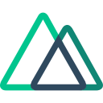
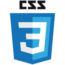

<!-- Animated Header -->

  
  

    
    
    
  

  

<!-- Visitor Counter -->

  

<!-- About Me -->

I'm a <strong>Software Developer</strong> focused on backend development, distributed systems, database engineering, cloud computing, and process automation.

I build REST APIs, asynchronous workflows, and database-driven applications, applying software engineering principles.

<!-- Contact Badges -->

  
  
  
  

<!-- Certifications -->

Certifications

<table align="center">
  <tr>
    <td width="76" align="center" valign="middle">
      
       
      <a href="https://learn.microsoft.com/api/credentials/share/es-es/ANDREACARRILLOOPORTO-6553/79C80AEA4FDDB812?sharingId=4B17552443EC43C4" title="AZ-900 — Microsoft Certified: Azure Fundamentals — View credential">AZ-900</a>
    </td>
    <td width="76" align="center" valign="middle">
      
       
      <a href="https://learn.microsoft.com/api/credentials/share/es-es/ANDREACARRILLOOPORTO-6553/730444074E386CBE?sharingId=4B17552443EC43C4" title="GH-900 — GitHub Foundations — View credential">GH-900</a>
    </td>
    <td width="76" align="center" valign="middle">
      
       
      <a href="https://learn.microsoft.com/api/credentials/share/es-es/ANDREACARRILLOOPORTO-6553/2DC1174F7D2F1F1B?sharingId=4B17552443EC43C4" title="SC-900 — Microsoft Certified: Security, Compliance, and Identity Fundamentals — View credential">SC-900</a>
    </td>
  </tr>
</table>

 

<!-- Core Tech Stack -->
<h3>💻 Core Tech Stack</h3>

<table width="100%">
  <tr>
    <th colspan="5" width="340" align="center" valign="middle">Programming Languages</th>
    <th colspan="4" width="340" align="center" valign="middle">Backend &amp; API Testing</th>
  </tr>
  <tr>
    <td width="47" align="center" valign="middle">
      
       
      Python
    </td>
    <td width="47" align="center" valign="middle">
      
       
      C++
    </td>
    <td width="46" align="center" valign="middle">
      
       
      Java
    </td>
    <td width="46" align="center" valign="middle">
      
       
      C#
    </td>
    <td width="46" align="center" valign="middle">
      
       
      JavaScript
    </td>
    <td width="65" align="center" valign="middle">
      
       
      FastAPI
    </td>
    <td width="65" align="center" valign="middle">
      
       
      .NET
    </td>
    <td width="65" align="center" valign="middle">
      
       
      Spring
    </td>
    <td width="64" align="center" valign="middle">
      
       
      Postman
    </td>
  </tr>
</table>

<table width="100%">
  <tr>
    <th colspan="4" width="340" align="center" valign="middle">Cloud &amp; Distributed Systems</th>
    <th colspan="4" width="340" align="center" valign="middle">Databases</th>
  </tr>
  <tr>
    <td width="65" align="center" valign="middle">
      
       
      Azure
    </td>
    <td width="65" align="center" valign="middle">
      
       
      Docker
    </td>
    <td width="65" align="center" valign="middle">
      
       
      RabbitMQ
    </td>
    <td width="64" align="center" valign="middle">
      
       
      Redis
    </td>
    <td width="65" align="center" valign="middle">
      
       
      PostgreSQL
    </td>
    <td width="65" align="center" valign="middle">
      
       
      SQL Server
    </td>
    <td width="65" align="center" valign="middle">
      
       
      MySQL
    </td>
    <td width="64" align="center" valign="middle">
      
       
      MongoDB
    </td>
  </tr>
</table>

<!-- Additional Technologies -->

  
<strong>Additional Technologies</strong>

<table width="100%">
  <tr>
    <th colspan="4" width="340" align="center" valign="middle">Backend &amp; Databases</th>
    <th colspan="4" width="340" align="center" valign="middle">Cloud Platforms &amp; Hosting</th>
  </tr>
  <tr>
    <td width="65" align="center" valign="middle">
      
       
      VB.NET
    </td>
    <td width="65" align="center" valign="middle">
      
       
      Django
    </td>
    <td width="65" align="center" valign="middle">
      
       
      Node.js
    </td>
    <td width="64" align="center" valign="middle">
      
       
      Oracle
    </td>
    <td width="65" align="center" valign="middle">
      
       
      Cloudflare
    </td>
    <td width="65" align="center" valign="middle">
      
       
      Netlify
    </td>
    <td width="65" align="center" valign="middle">
      
       
      Vercel
    </td>
    <td width="64" align="center" valign="middle">
      
       
      Firebase
    </td>
  </tr>
</table>

<table width="100%">
  <tr>
    <th colspan="3" width="340" align="center" valign="middle">Version Control &amp; DevOps</th>
    <th colspan="3" width="340" align="center" valign="middle">Testing &amp; QA</th>
  </tr>
  <tr>
    <td width="96" align="center" valign="middle">
      
       
      Git
    </td>
    <td width="95" align="center" valign="middle">
      
       
      GitHub
    </td>
    <td width="95" align="center" valign="middle">
      
       
      Azure DevOps
    </td>
    <td width="96" align="center" valign="middle">
      
       
      Selenium
    </td>
    <td width="95" align="center" valign="middle">
      
       
      NUnit
    </td>
    <td width="95" align="center" valign="middle">
      
       
      PyTest
    </td>
  </tr>
</table>

<table width="100%">
  <tr>
    <th colspan="4" width="340" align="center" valign="middle">Frontend Frameworks &amp; Tooling</th>
    <th colspan="4" width="340" align="center" valign="middle">Data Analysis &amp; Scientific Computing</th>
  </tr>
  <tr>
    <td width="65" align="center" valign="middle">
      
       
      React
    </td>
    <td width="65" align="center" valign="middle">
      
       
      Vue.js
    </td>
    <td width="65" align="center" valign="middle">
      
       
      Nuxt
    </td>
    <td width="64" align="center" valign="middle">
      
       
      Vite
    </td>
    <td width="65" align="center" valign="middle">
      
       
      Pandas
    </td>
    <td width="65" align="center" valign="middle">
      
       
      NumPy
    </td>
    <td width="65" align="center" valign="middle">
      
       
      Matplotlib
    </td>
    <td width="64" align="center" valign="middle">
      
       
      SciPy
    </td>
  </tr>
</table>

<table width="100%">
  <tr>
    <th colspan="3" width="340" align="center" valign="middle">Web Foundations &amp; UI Design</th>
    <th colspan="3" width="340" align="center" valign="middle">Low-Code Platforms</th>
  </tr>
  <tr>
    <td width="96" align="center" valign="middle">
      
       
      HTML5
    </td>
    <td width="95" align="center" valign="middle">
      
       
      CSS3
    </td>
    <td width="95" align="center" valign="middle">
      
       
      Figma
    </td>
    <td width="96" align="center" valign="middle">
      
       
      FlutterFlow
    </td>
    <td width="95" align="center" valign="middle">
      
       
      Power Apps
    </td>
    <td width="95" align="center" valign="middle">
      
       
      Oracle APEX
    </td>
  </tr>
</table>

<table width="100%">
  <tr>
    <th colspan="2" width="340" align="center" valign="middle">CSS Frameworks</th>
    <th colspan="2" width="340" align="center" valign="middle">Mobile Development</th>
  </tr>
  <tr>
    <td width="157" align="center" valign="middle">
      
       
      Bootstrap
    </td>
    <td width="156" align="center" valign="middle">
      
       
      Tailwind CSS
    </td>
    <td width="157" align="center" valign="middle">
      
       
      Kotlin
    </td>
    <td width="156" align="center" valign="middle">
      
       
      Android Studio
    </td>
  </tr>
</table>

<table width="100%">
  <tr>
    <th colspan="2" width="340" align="center" valign="middle">BI &amp; Data Integration</th>
    <th colspan="2" width="340" align="center" valign="middle">Automation &amp; RPA</th>
  </tr>
  <tr>
    <td width="157" align="center" valign="middle">
      
       
      Power BI
    </td>
    <td width="156" align="center" valign="middle">
      
       
      SSIS
    </td>
    <td width="157" align="center" valign="middle">
      
       
      UiPath
    </td>
    <td width="156" align="center" valign="middle">
      
       
      Power Automate
    </td>
  </tr>
</table>

<!-- Engineering Practices -->
<h3>⚙️ Engineering Practices</h3>

<table width="100%">
  <tr>
    <th align="left" valign="middle" width="193">Software Design</th>
    <td width="487">OOP · SOLID · Design Patterns · Data Structures · Algorithms</td>
  </tr>
  <tr>
    <th align="left" valign="middle" width="193">Software Architecture</th>
    <td width="487">REST APIs · Microservices · Distributed Systems · Asynchronous Messaging</td>
  </tr>
  <tr>
    <th align="left" valign="middle" width="193">Software Quality</th>
    <td width="487">Automated Testing · CI/CD · Version Control</td>
  </tr>
</table>

<!-- Applied NLP Focus -->
<h3>🌿 Applied NLP Focus</h3>

  Natural Language Processing · spaCy · pdfplumber · information extraction · document automation

<!-- GitHub Activity -->
<h3>⚡ GitHub Activity</h3>

  <!-- General Statistics -->
  
  <!-- Top Languages -->
  

  <!-- Contribution Streak -->
  

<!-- Space Invaders Contribution Graph -->
### Space Invaders

<picture>
  <source media="(prefers-color-scheme: dark)" srcset="https://raw.githubusercontent.com/AndreaCarrilloOp/contributionDynamic/output/invaders-dark.svg">
  <source media="(prefers-color-scheme: light)" srcset="https://raw.githubusercontent.com/AndreaCarrilloOp/contributionDynamic/output/invaders-light.svg">
  
</picture>

Implemented by Andrea Carrillo · <a href="https://github.com/AndreaCarrilloOp/contributionDynamic" target="_blank" rel="noopener noreferrer">contributionDynamic</a> · <a href="https://raw.githubusercontent.com/AndreaCarrilloOp/contributionDynamic/output/invaders-dark.svg">Dark</a> · <a href="https://raw.githubusercontent.com/AndreaCarrilloOp/contributionDynamic/output/invaders-light.svg">Light</a>

